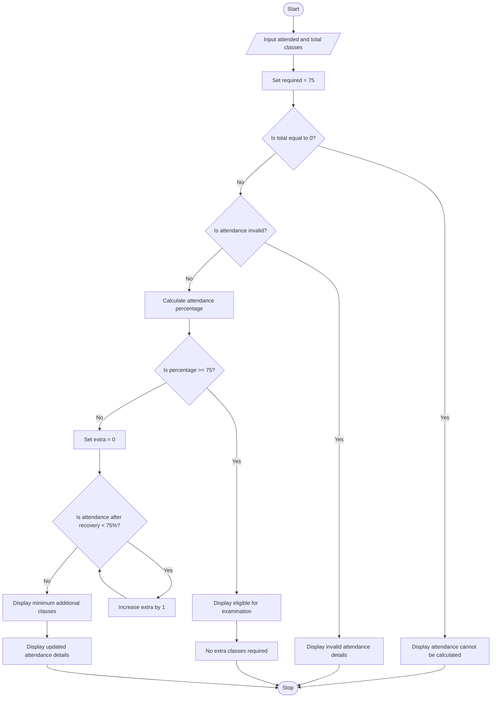

##Case Study 12: Attendance Recovery Computation
##1. Problem Statement
The Attendance Recovery Computation program calculates a student's current attendance percentage based on the number of classes attended and the total classes conducted. The minimum attendance requirement is 75%. If the student is not eligible for the examination, the program calculates the minimum number of additional consecutive classes the student must attend to reach 75% attendance.

##3. Algorithm
1. Start the program.
2. Read the number of classes attended and the total classes conducted.
3. Set the required attendance percentage to 75%.
4. If the total classes are zero, display an error message.
5. If the attendance details are invalid, display an invalid input message.
6. Calculate the current attendance percentage.
7. If attendance is 75% or more, display that the student is eligible.
8. Otherwise, calculate the minimum additional classes required using a while loop.
9. Display the additional classes required and the updated attendance details.
10. Stop the program.

## Flowchart

5. Sample Input
   Enter classes attended: 60
Enter total classes conducted: 100

6.Sample Output
Current Attendance: 60.0 %
You are not eligible yet.
Minimum additional classes required: 60
Total classes after recovery: 160
Total attended classes: 120

